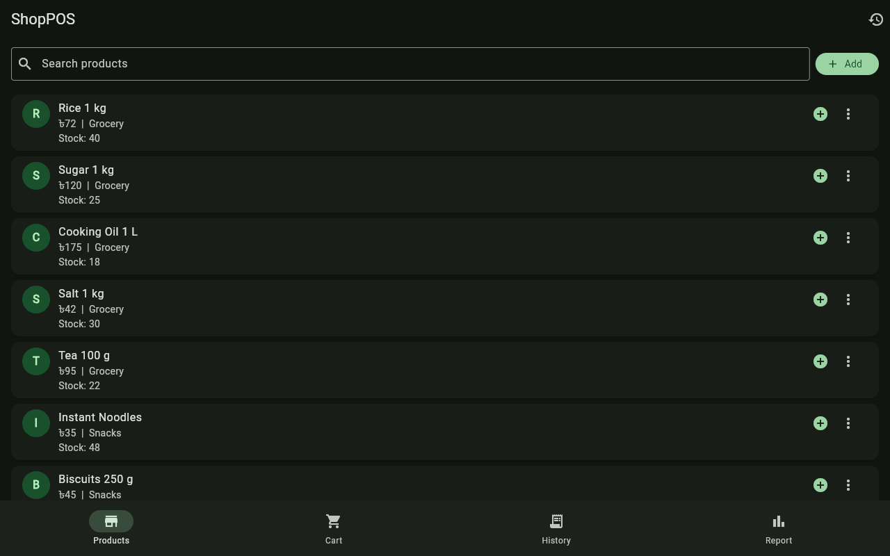
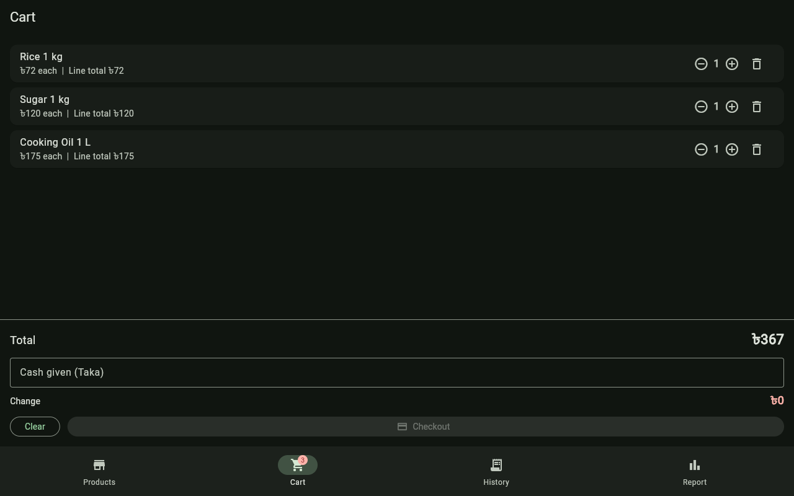
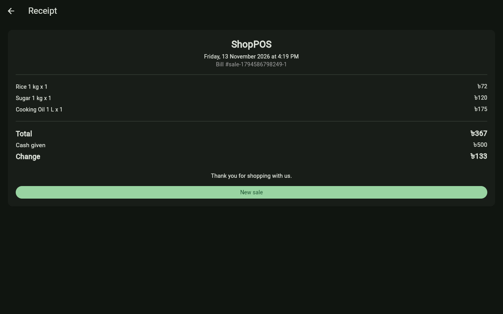
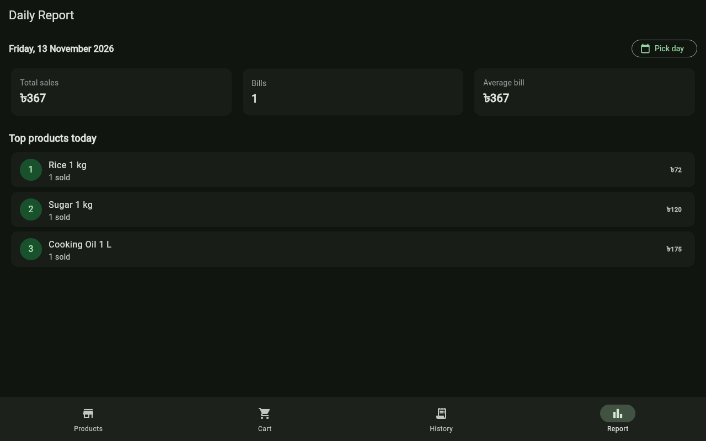

# ShopPOS

Offline first point of sale app for small shops, built with Flutter. Day 4 of a one app per day reference build series by Partho Sarothi Paik.

Try it in your browser: https://codebypartho.github.io/shop-pos/

## Download the APK

Download the APK from the [v1.1.0 release](https://github.com/CodeByPartho/shop-pos/releases) on GitHub. Two files: `shop-pos-v1.1.0.apk` (works on all phones) and `shop-pos-v1.1.0-arm64.apk` (smaller, for modern 64-bit phones).

## Screenshots

Screenshots below are from v1.0.0. The v1.1.0 screens keep the same dark theme and layout, with a Khata tab added.






## What it does

- **Products:** list of shop products with price, cost price, stock and barcode. Add a new product (name, price, cost price, opening stock, category, barcode, low-stock level), search by name or barcode, edit, add stock, or delete a product. Category and low-stock filters included.
- **Barcode scanning:** scan a product barcode with the camera, or type it in. A known barcode adds the item to the cart; an unknown one opens the add-product form with the code filled in. On the web demo the camera may be unavailable, and manual entry still works.
- **Cart:** add items from the product list, change quantities, remove items. The cart never lets you add more than the stock on hand. Park a sale mid-queue and resume it later.
- **Checkout:** bill discount by percent or Taka, optional tax/VAT (off by default, set in shop settings), payment by cash, bKash, Nagad, split payment or credit. Quick cash buttons (Exact, 100, 500, 1000, 2000). Checkout saves the sale and decrements stock. A payment short of the total cannot be checked out, except on a credit sale where the rest goes to the khata.
- **Khata (credit ledger):** customers who buy on credit, each with a balance owed and a ledger of credit sales and payments. Record payments in cash, bKash or Nagad, and share a payment reminder as text.
- **Receipt:** after checkout, a receipt screen shows the bill number, items, subtotal, discount, tax, total, payment method, paid amount, change or amount due. Share the receipt as text or copy it. Any past sale can be reopened from History.
- **Sales history:** past sales grouped by day, with bill count and day total. Each sale shows its payment method and any amount still due.
- **Report:** day, week or month view with total sales, number of bills, average bill, gross profit, margin, expenses, net profit, cash in drawer, total khata outstanding, a sales bar chart, totals by payment method, top products and most profitable products.
- **Expenses:** record rent, transport, supplies and helper pay; net profit in the report is gross profit minus expenses.
- **Low-stock alerts:** each product warns at or below its set level (default 5). Low items get a badge and a filter chip, and the Products tab shows a count.
- **Offline first:** all data is stored on the device with shared_preferences (JSON). No account, no server, no internet needed. Data saved by v1.0.0 still loads in v1.1.0.

## Demo data

The app ships with 12 realistic shop products (rice, sugar, cooking oil, salt, tea, noodles, biscuits, eggs, milk, soap, shampoo, toothpaste) priced in Taka, each with a cost price and a demo barcode. Use the reset button in the app bar to restore the demo products and clear all sales, khata, expenses and parked sales.

## Tech

- Flutter with Material 3 dark theme and a #39FF88 accent
- State: provider
- Persistence: shared_preferences (JSON)
- Formatting: intl (Taka currency, dates)
- Barcode scanning: mobile_scanner (camera; ML Kit on Android)
- Receipt sharing: share_plus
- Dependencies: provider, intl, shared_preferences, mobile_scanner, share_plus, flutter_lints (dev)

## Run it

```bash
flutter pub get
flutter run
```

## Tests

```bash
flutter test
```

49 unit tests cover cart totals, change due, stock decrement (including over-selling and out of stock cases), daily sales filtering, daily summaries and top product ranking, plus bill math (discount, tax, rounding, edge cases), profit and net profit, barcode lookup, low-stock thresholds, khata balances, payment method totals, cash drawer totals, week and month ranges, and loading of v1.0.0 saved data.

## Project structure

- `lib/models/models.dart` - Product, SaleItem, Sale, Customer, LedgerEntry, Expense and ParkedSale models with JSON support
- `lib/logic/pos_logic.dart` - pure logic: cart totals, bill pricing, profit, barcode lookup, low stock, khata balances, daily/weekly/monthly summaries, top products
- `lib/state/pos_state.dart` - app state, cart, checkout, khata, expenses, parked sales, persistence and demo seed
- `lib/screens/` - products, cart, receipt, history, report, khata, barcode scanner and main shell
- `lib/utils/format.dart` - Taka and date formatting
- `lib/utils/receipt_text.dart` - plain-text receipt and khata reminder text for sharing
- `lib/utils/share_text.dart` - share sheet with clipboard fallback
- `test/pos_logic_test.dart` - unit tests for the logic layer
